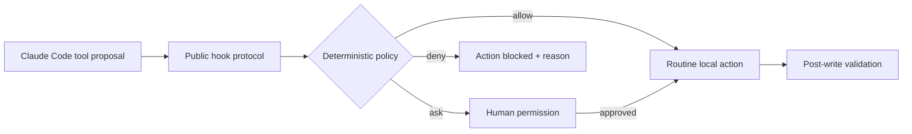

# ALL-ABT-CLAUDE — Deterministic Claude Code Guardrails

[](https://github.com/JoaoToni12/ALL-ABT-CLAUDE/actions/workflows/ci.yml)

Deterministic, testable guardrails for using Claude Code on real engineering
projects — **allow routine verification, ask before high-impact changes, and
deny configured destructive operations before they run**.

This clean-room toolkit turns agent operating rules into executable policy. It
uses Claude Code's public hook interface, runs locally without a model call, and
ships with synthetic tests for the allow, ask, deny, malformed-input, and path-
escape paths.

## What it demonstrates

- **Agent governance:** structured `PreToolUse` decisions instead of prompt-only
  safety guidance.
- **Safe automation:** destructive Git, broad deletion, raw-device, remote,
  release, and deployment operations are classified before execution.
- **Boundary validation:** writes stay inside `CLAUDE_PROJECT_DIR` and avoid Git
  internals, private keys, credential files, and symlink escapes.
- **Verification:** JSON writes are checked after editing without returning file
  contents; policy and protocol behavior are covered by dependency-free tests.
- **Operational quality:** versioned configuration, fail-closed inputs, CI,
  threat model, ADR, security policy, and one-command local checks.

## Decision flow



| Proposal | Decision | Why |
|---|---:|---|
| `git diff --stat` | allow | configured local inspection |
| `git push origin feature/guardrails` | ask | changes remote state |
| `rm -rf build` | ask | recursive deletion needs target review |
| `git reset --hard` | deny | can discard uncommitted work |
| write `../credentials.json` | deny | outside workspace and credential-like |

## Try it in two minutes

Requires Node.js 22 or newer. No package dependency, API key, or Claude account is
required to run the demo and tests.

```bash
git clone https://github.com/JoaoToni12/ALL-ABT-CLAUDE.git
cd ALL-ABT-CLAUDE
npm ci
npm run demo
npm run check
```

Expected demo decisions:

```text
Inspect changes  -> allow
Publish branch   -> ask
Discard work     -> deny
```

## Enable the hooks in a project

From the project that should use the guards, render an untracked local settings
file:

```bash
node /path/to/ALL-ABT-CLAUDE/scripts/render-settings.mjs --write
```

Run the command without `--write` to print the rendered JSON for inspection or
for merging into an existing `.claude/settings.json`. The renderer uses Claude
Code's shell-free exec form (`command` plus `args`), so spaces and shell
metacharacters in absolute paths remain inert.

The generated configuration attaches:

- `hooks/pre-bash-guard.mjs` to `PreToolUse` for Bash;
- `hooks/pre-write-guard.mjs` to `PreToolUse` for Write and Edit;
- `hooks/post-json-validator.mjs` to `PostToolUse` for Write and Edit.

Customize `config/policy.json`, then run `npm run check`. Invalid policies fail
at startup. Unknown Bash commands default to `ask`.

## Design boundaries

This project complements Claude Code's native permissions; it does not replace
them. Regexes are not a shell sandbox, and local hooks cannot replace server-
side authorization, protected branches, secret scanning, narrow credentials,
or human review. Read the [threat model](docs/threat-model.md) and
[design decision](docs/adr/0001-deterministic-local-guards.md) before adapting
the policy to production work.

The implementation follows Anthropic's public
[hooks reference](https://code.claude.com/docs/en/hooks). It is an independent
clean-room project, is not affiliated with Anthropic, and contains no employer
code, data, prompts, workflow exports, schemas, identifiers, or business rules.

## Repository map

```text
config/   versioned decision policy
hooks/    Claude Code hook entry points
lib/      pure classification and protocol logic
scripts/  demo, settings renderer, and syntax gate
test/     policy, boundary, validation, and protocol tests
docs/     threat model and architecture decision record
```

Contributions are welcome under the [MIT license](LICENSE). Keep examples
synthetic and run `npm run check` before opening a pull request.
